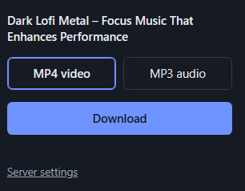

# YT Grabber


Save the current YouTube video as **MP4** or **MP3** with one click, using a server **you run yourself** (Flask + [yt-dlp](https://github.com/yt-dlp/yt-dlp) + ffmpeg).

> **Use responsibly.** Only download videos you own or have permission to download. You are responsible for following YouTube's Terms of Service and copyright law. This project is not affiliated with or endorsed by YouTube or Google.

<!-- Add a screenshot of the popup here:

-->

## Features

- One-click **MP4** (H.264 + AAC, plays almost everywhere) or **MP3** (192 kbps)
- **Live progress bar** while the server downloads and converts
- **Self-hosted**: no third-party service, no accounts, nothing sent anywhere but your own server
- **Docker setup** with ffmpeg included, or run it directly with Python
- Optional **API key** for servers reachable outside your computer
- Files are streamed straight to disk by Chrome and deleted from the server after an hour

## How it works

```
Chrome extension  ──(URL + format)──►  Flask server (yt-dlp + ffmpeg)
       ▲                                        │
       └──────── progress updates, then the finished file ◄──┘
```

The extension sends the video link and chosen format to your server. The server downloads and converts it, reports progress, and the extension saves the finished file through Chrome's downloads.

## Quick start

### 1. Start the server

**Docker (recommended, ffmpeg included):**

```
docker compose up -d --build
```

**Python (3.10+):**

```
cd backend
pip install -r requirements.txt
python app.py
```

If ffmpeg isn't installed, the server downloads a copy automatically on first start (internet needed once). Installing ffmpeg yourself also works.

Either way, the server listens on `http://127.0.0.1:5000`.

### 2. Install the extension

1. Open `chrome://extensions` and turn on **Developer mode**.
2. Click **Load unpacked** and choose the `extension` folder.
3. Click the extension icon, open **Server settings**, and press **Test connection**. The default address already matches the setup above.

### 3. Download

Open a YouTube video, click the extension icon, pick MP4 or MP3, and press **Download**.

> The Chrome Web Store doesn't accept YouTube downloaders, so the extension is installed unpacked.

## Using it from other devices or away from home

1. Set an API key: `API_KEY=some-long-random-string docker compose up -d`
2. Put the server behind **HTTPS** (a reverse proxy, or a free Cloudflare Tunnel). Don't send the key over plain HTTP across the internet.
3. In the extension's **Server settings**, enter the HTTPS address and the same key. Chrome will ask permission to reach that address.

To accept connections from other machines on your network without a tunnel, change the port mapping in `docker-compose.yml` from `127.0.0.1:5000:5000` to `5000:5000`, and set an API key.

## Configuration

| Variable  | Where       | Default     | Purpose                                         |
|-----------|-------------|-------------|-------------------------------------------------|
| `API_KEY` | server      | *(none)*    | If set, the extension must send it to the server |
| `PORT`    | server      | `5000`      | Port when running `python app.py`                |
| `HOST`    | server      | `127.0.0.1` | Bind address when running `python app.py`        |

The server address and API key are set in the extension's **Server settings** page.

## Troubleshooting

- **"ffmpeg not found"**: use Docker, run `winget install Gyan.FFmpeg` (Windows) or install it with your package manager, then restart the server from a **new** terminal.
- **"An attempt was made to access a socket in a way forbidden by its access permissions" (Windows)**: port 5000 is in use or reserved. Pick another port (`$env:PORT=5050; python app.py`), then update the address in Server settings.
- **Downloads suddenly fail**: update yt-dlp (`docker compose build --no-cache`, or `pip install -U yt-dlp`). YouTube changes break it often.
- **"Sign in to confirm you're not a bot"**: usually means the server runs on a cloud or datacenter IP. Run it from a home connection.
- **MP4 won't play**: the server prefers H.264, but videos with no H.264 stream fall back to AV1 or VP9. Use VLC or install the AV1 codec.

## Project structure

```
backend/     Flask app, Dockerfile, requirements
extension/   Chrome extension (Manifest V3): popup, options page, service worker
docker-compose.yml
```

## License

[MIT](LICENSE). yt-dlp and ffmpeg are separate projects with their own licenses.
